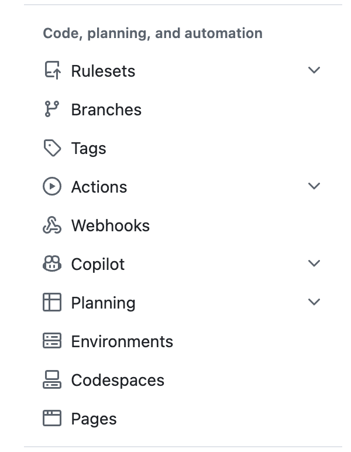

## Today's Plan

- Walk through steps for creating a website

- Updating and maintaining

## By the end, you should know:

- How to make your own website for a portfolio, event, or just for fun!
- How to create a custome domain

## Using a template or starting from scratch

- Either way is perfectly fine, its users preference.
- **Utilize public github repos!!!!**
- Search on github for a template you like, clone repo!

## What is Github Pages?

- Staic site hosting service
- Takes HTML, CSS, and JS files right from a repo, builds, and publishes a website
- You can host your own domain or use the standard github.io/user domain

## Necesssary Files

- index.qmd
  - Default homepage, primary entry point
- _quarto.yml
  - Config file, themes, layouts, visuals

## Setting up Pages

{width=400} 

Build and deployment, deploy from branch 
chose main and /docs folder! 

## Custom domain
- If you choose, you can go to any domain site and pay cents for a domain, namecheap
- Type in the settings, DNS check to see if it is a real domain 

## Live demo
- My websites!